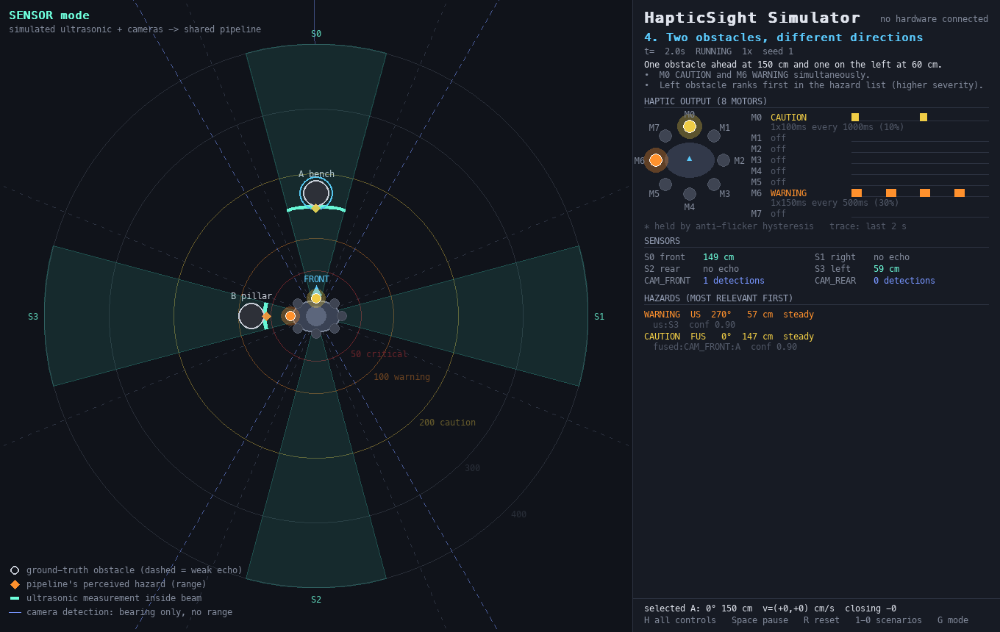

# HapticSight

**A wearable obstacle-awareness prototype that turns computer vision and ultrasonic ranging into
directional vibration around the torso.**

HapticSight detects obstacles around a person and communicates *direction*, *proximity*, and
*urgency* through eight vibration motors placed at 45° intervals around a vest. This repository
holds the software: a modular Python pipeline (perception → risk assessment → haptic encoding)
and an interactive simulator that runs the same pipeline with no hardware attached.

> ⚠️ **Safety disclaimer.** HapticSight is an experimental engineering prototype. It is **not** a
> validated mobility aid, medical device, or collision-avoidance system, and must not be relied on
> for personal safety. Nothing here has been tested on the physical vest yet.



---

## Contents

- [Project status](#project-status)
- [Hardware overview](#hardware-overview)
- [System architecture](#system-architecture)
- [Installation](#installation)
- [Running the simulator](#running-the-simulator)
- [Controls](#controls)
- [Predefined scenarios](#predefined-scenarios)
- [Testing](#testing)
- [Hardware integration plan](#hardware-integration-plan)
- [Limitations](#limitations)
- [Documentation](#documentation)

## Project status

**Milestone 1: software foundation and interactive simulator** (this branch).

| Area | Status |
|------|--------|
| Shared data model, body-frame geometry, hardware layout contract | ✅ Implemented and tested |
| Ultrasonic interpretation, closing-speed estimation, sensor health | ✅ Implemented and tested |
| Camera/ultrasonic fusion (gating-based foundation) | ✅ Implemented and tested |
| Deterministic, explainable risk engine | ✅ Implemented and tested |
| Haptic encoder: 8 channels, pulse patterns, conflict resolution, hysteresis | ✅ Implemented and tested |
| Interactive Pygame simulator with 10 deterministic scenarios | ✅ Implemented, regression-tested headless |
| Serial protocol v1 (host side): codec, framing, link monitor, Arduino bridge | ✅ Implemented and tested with a fake transport |
| Arduino firmware | ⏳ Planned. Specified in [PROTOCOL.md](docs/PROTOCOL.md), **not implemented** |
| Webcam capture and object detection | ⏳ Planned. Interface only |
| Integration with physical sensors, motors, vest | ⏳ Planned. **Not validated** |

## Hardware overview

| Component | Role |
|-----------|------|
| MacBook Air M1 (8 GB) | Python: vision, fusion, risk, haptic encoding |
| Arduino Uno | Ultrasonic ranging, serial link, low-level motor timing |
| 2 × USB webcams | Forward- and rear-facing vision (bearing-only detections) |
| 4 × HC-SR04 ultrasonic sensors | Range in four sectors: S0 front, S1 right, S2 rear, S3 left |
| 8 × coin ERM vibration motors | M0 front … M7 front-left, 45° apart, on/off only |
| 74HC595 + ULN2803A | 8-channel output expansion and motor switching |

Coordinate system: bearings in degrees, **0° forward, clockwise** (90° right, 180° behind,
270° left). Distances are clearances from the torso surface in centimetres. Full contract:
[docs/HARDWARE_INTERFACE.md](docs/HARDWARE_INTERFACE.md).

```
              M7  M0  M1                    S0 (0°)
                \ | /                          │
           M6 ── (●) ── M2         S3 (270°) ──●── S1 (90°)
                / | \                          │
              M5  M4  M3                    S2 (180°)
```

## System architecture

```
ultrasonic readings ─┐
                     ├─► perception ─► risk engine ─► haptic encoder ─► 8 motor patterns
camera detections ───┘  (fusion)      (explainable)   (timing-coded)      │
                                                                         ▼
                                              PulseScheduler (sim) / Arduino firmware (future)
```

```
hapticsight/
  core/         Observation model, geometry, layout contract, clocks
  perception/   ultrasonic front end, range-rate, camera buffer, fusion
  risk/         distance bands, motion, time-to-contact, prioritisation
  haptics/      bearing→motor mapping, pulse patterns, encoder, scheduler
  protocol/     serial protocol v1: messages, codec, framing, link monitor
  hardware/     device interfaces + host-side Arduino bridge
  simulation/   world, simulated sensors, scenarios, engine, CLI, Pygame app
  pipeline.py   the single shared processing chain
  config.py     configuration aggregate + TOML overrides
```

The simulator calls exactly the same `HapticSightPipeline` the hardware runtime will call; only
the data sources differ. See [docs/ARCHITECTURE.md](docs/ARCHITECTURE.md) for interfaces and the
design-decision log.

### How a warning is produced

1. **Perception.** Each ultrasonic echo becomes an observation at the sensor's bearing, with
   ±15° bearing uncertainty (the beam width). Closing speed is estimated from range history and
   is *unknown* until there is enough evidence. Camera detections carry a bearing only, no range.
   When a camera detection lines up with a fresh echo they are fused: camera bearing plus
   ultrasonic range.
2. **Risk.** Default bands: **< 50 cm critical**, **50–100 cm warning**, **100–200 cm caution**,
   **> 200 cm none** (configurable). A measured approach can raise severity through
   time-to-contact. Stale (> 0.5 s) or low-confidence (< 0.35) observations are shown but never
   warn. Objects without a measured range get **no** distance band.
3. **Haptics.** Each hazard drives the motor(s) covering its bearing. If several hazards hit the
   same motor, the most urgent wins. Urgency is encoded in timing:

   | Level | Pattern | Approaching variant |
   |-------|---------|---------------------|
   | Caution | 1 Hz single tap (10 % duty) | 1 Hz double tap |
   | Warning | 2 Hz single tap (30 %) | 2 Hz double tap |
   | Critical | 4 Hz near-continuous (72 %) | 4 Hz double tap (80 %) |
   | Degraded sensor | sparse triple blip every 2 s | — |

   Escalation is immediate; stepping down waits 0.35 s, which prevents flicker.

## Installation

Requires **Python 3.11+** (macOS ships 3.9, so install a newer one, e.g. `brew install python@3.11`).
No Arduino, camera, GPU, or network service is needed.

```bash
git clone https://github.com/Dold18/HapticSIght.git
cd HapticSIght
python3.11 -m venv .venv
source .venv/bin/activate
pip install -e ".[dev]"        # or ".[sim]" for just the simulator
```

## Running the simulator

```bash
hapticsight-sim                 # opens scenario 1
hapticsight-sim -s 8            # open a specific scenario (0 = empty sandbox)
hapticsight-sim --ground-truth  # start in oracle perception mode
hapticsight-sim --list          # list scenarios
python -m hapticsight.simulation   # same as hapticsight-sim
```

Headless use, with no window:

```bash
hapticsight-sim --headless -s 2                 # text timeline of motor states + top hazards
hapticsight-sim --headless -s 7 --ground-truth  # compare with perfect perception
hapticsight-sim -s 8 --screenshot out.png --at 3.4
hapticsight-sim --config config/example.toml    # override thresholds / timings
```

What you see:

* **Left:** top-down view. White circles are the *ground-truth* obstacles. Teal wedges are the
  ultrasonic beams; a bright arc inside a wedge is the sensor's *measurement*. Blue rays are camera
  detections (bearing only). Diamonds show where the *pipeline* believes a hazard is. The wearer
  sits in the centre with eight motors that light up in time with their pulse pattern.
* **Right:** scenario description and expected outcome; the 8-motor vest with each channel's
  pattern and a 2-second pulse trace; sensor status; and the ranked hazard list with reasons.

<p align="center">
  
  
</p>

## Controls

| Input | Action |
|-------|--------|
| Left-click empty space | Add obstacle (and select it) |
| Left-drag obstacle | Move it |
| Right-click obstacle | Delete it |
| Mouse wheel | Zoom |
| Tab | Select next obstacle |
| Arrows / Shift+Arrows | Move selected 10 cm / change its velocity by 10 cm/s |
| A / V | Selected obstacle walks toward the wearer at 50 cm/s / stops |
| Delete | Remove selected |
| Space / `.` | Pause-resume / single step while paused |
| R | Reset scenario |
| 1–9, 0 | Load scenario 1–10 |
| E | Empty sandbox |
| N | New obstacle 150 cm ahead |
| `[` / `]` | Slower / faster (0.25×–2×) |
| G | Toggle sensor perception ↔ ground-truth perception |
| Shift+1…4 | Cycle ultrasonic S0…S3: ok → dropout → fault |
| Shift+5 / Shift+6 | Front / rear camera on-off |
| H | Help overlay |
| Esc / Q | Quit |

## Predefined scenarios

Every scenario is deterministic (seeded) and has an automated regression test that checks the
outcome listed here (`tests/test_scenarios.py`).

| # | Scenario | Expected outcome (sensor mode) |
|--:|----------|--------------------------------|
| 1 | Obstacle directly ahead (80 cm) | M0 WARNING only |
| 2 | Approaching from the right at 60 cm/s | M2 CAUTION → WARNING → CRITICAL with approach cue; time-to-contact warns before the 100 cm band; camera-blind side, ultrasonic only |
| 3 | Obstacle behind (75 cm) | M4 WARNING only |
| 4 | Two obstacles, different directions | M0 CAUTION and M6 WARNING simultaneously |
| 5 | Two obstacles competing for M0 | S0 reports only the nearest echo; M0 resolves to WARNING |
| 6 | Obstacle moving away | M0 steps down CRITICAL → WARNING → CAUTION → off, no approach cue |
| 7 | Object crossing in front | M0 active only while the object is in front; off before and after |
| 8 | Sensor dropout and fault | WARNING → DEGRADED cue during S0 dropout (no fabricated range) → WARNING on recovery; S1 fault → M2 DEGRADED |
| 9 | Obstacle drifting across 359°/0° | Only M0 driven throughout; bearing wraps cleanly |
| 10 | Conflicting / uncertain observations | Unranged camera-only object gets no band; low-confidence ghost ignored; intermittent echo smoothed |

## Testing

```bash
pytest                      # full suite: unit, integration, scenario regression, GUI smoke
ruff check . && ruff format --check .
mypy
```

GUI tests use SDL's dummy video driver, so the suite runs without a display. GitHub Actions runs
lint, type checks, and tests on every push and pull request
([.github/workflows/ci.yml](.github/workflows/ci.yml)).

## Hardware integration plan

1. **Arduino firmware** implementing [protocol v1](docs/PROTOCOL.md): sequential HC-SR04 ranging,
   `$US`/`$ST` reporting, `$HAP` execution with TTL, built-in pattern table, and the
   ultrasonic-only fallback mode.
2. **Serial transport**: a `pyserial`-backed `ByteTransport` for `ArduinoBridge`, plus a
   hardware-in-the-loop runtime (`poll → pipeline.process → send` at 10–20 Hz).
3. **Bench validation**: measured beam width, range noise, and latency on the real sensors;
   tune `UltrasonicConfig` and pattern timings with the actual motors.
4. **Cameras**: capture plus a lightweight detector on the M1 CPU, implementing `CameraDetector`
   with calibrated bearing per pixel column.
5. **Wearable trials**: perceptual tuning of patterns (distinguishability, fatigue) in controlled,
   supervised settings.

## Limitations

* **No hardware validation.** All behaviour shown is simulated; sensor models are simplified
  (no multipath, specular reflection, cross-talk, or occlusion between obstacles).
* **Four ultrasonic sectors.** Blind zones exist around the diagonals; diagonal motors are driven
  only when camera bearings are fused with an echo (or in ground-truth mode).
* **Camera-only objects are not haptically signalled.** Without a measured range they get no
  distance band. This is deliberate (no fabricated range), but it means a soft or absorbent obstacle
  seen only by the camera produces no vibration.
* **Fusion is a simple gate.** Ambiguous associations are resolved conservatively and flagged.
* **Stationary-wearer simulation.** Obstacles move relative to a stationary wearer; wearer walking
  is equivalent for range-rate purposes but is not modelled explicitly.
* **Provisional parameters.** Thresholds, beam width, and pulse timings are starting points that
  need measurement and user testing.

## Documentation

| Document | Purpose |
|----------|---------|
| [docs/ARCHITECTURE.md](docs/ARCHITECTURE.md) | Data flow, interfaces, design-decision log |
| [docs/HARDWARE_INTERFACE.md](docs/HARDWARE_INTERFACE.md) | Sensor/motor numbering, coordinates, HW/SW boundary |
| [docs/PROTOCOL.md](docs/PROTOCOL.md) | Serial protocol v1 specification |
| [docs/DEVELOPMENT_STATUS.md](docs/DEVELOPMENT_STATUS.md) | Milestone status, decisions, test results, next steps |
| [CLAUDE.md](CLAUDE.md) | Conventions and instructions for coding agents |
