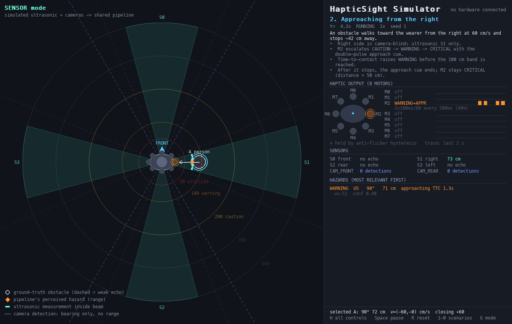
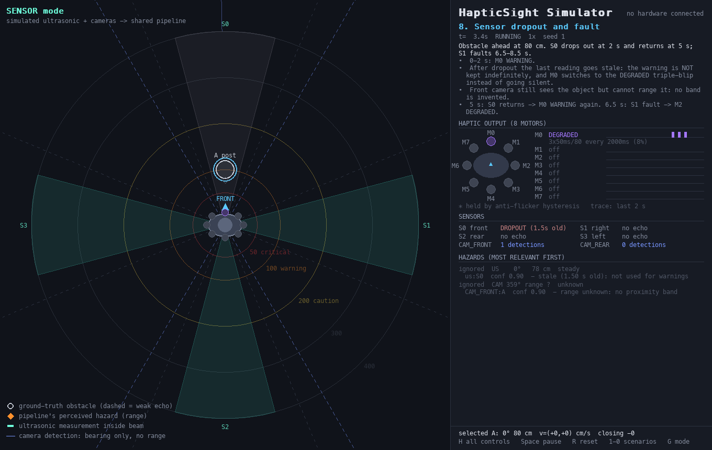
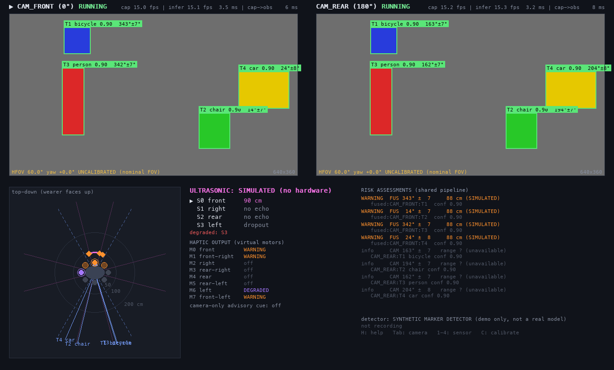
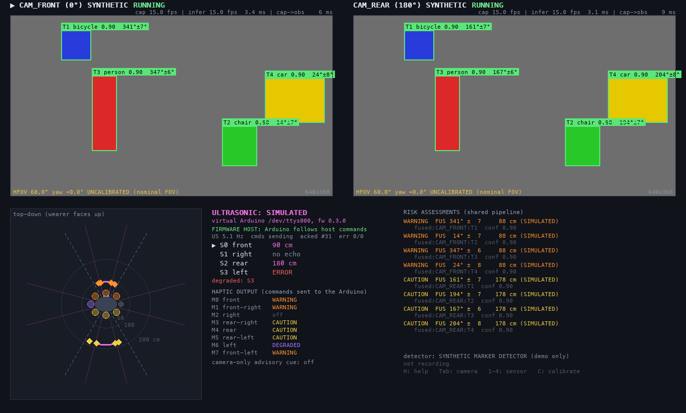

# HapticSight

**A wearable obstacle-awareness prototype that turns computer vision and ultrasonic ranging into
directional vibration around the torso.**

HapticSight detects obstacles around a person and communicates *direction*, *proximity*, and
*urgency* through eight vibration motors placed at 45° intervals around a vest. This repository
holds the software: a modular Python pipeline (perception → risk assessment → haptic encoding),
an interactive simulator that runs the same pipeline with no hardware attached, and real-time
dual-camera computer vision (object detection, tracking, and bearing estimation) that feeds that
same pipeline.

> ⚠️ **Safety disclaimer.** HapticSight is an experimental engineering prototype. It is **not** a
> validated mobility aid, medical device, or collision-avoidance system, and must not be relied on
> for personal safety. Nothing here has been tested on the physical vest yet.


---

## Contents

- [Project status](#project-status)
- [Hardware overview](#hardware-overview)
- [System architecture](#system-architecture)
- [Installation](#installation)
- [Running the simulator](#running-the-simulator)
- [Controls](#controls)
- [Predefined scenarios](#predefined-scenarios)
- [Computer vision](#computer-vision)
- [Arduino firmware and hardware runtime](#arduino-firmware-and-hardware-runtime)
- [Testing](#testing)
- [Hardware integration plan](#hardware-integration-plan)
- [Limitations](#limitations)
- [Documentation](#documentation)

## Project status

**Milestones 1** (software foundation and simulator) **and 2** (dual-camera computer vision) are
merged. **Milestone 3** (Arduino firmware and end-to-end serial integration) is on
`feature/arduino-firmware-serial-integration`.

| Area | Status |
|------|--------|
| Shared data model, body-frame geometry, hardware layout contract | ✅ Implemented and tested |
| Ultrasonic interpretation, closing-speed estimation, sensor health | ✅ Implemented and tested |
| Camera/ultrasonic fusion (gating, conservative confidence) | ✅ Implemented and tested (confidence fix in M2) |
| Deterministic, explainable risk engine | ✅ Implemented and tested |
| Haptic encoder: 8 channels, pulse patterns, conflict resolution, hysteresis | ✅ Implemented and tested |
| Interactive Pygame simulator with 10 deterministic scenarios | ✅ Implemented, regression-tested headless |
| Serial protocol v1: host codec, pyserial transport, handshake/reconnect state machine | ✅ Implemented; tested against the firmware logic over a pseudo-terminal |
| Arduino Uno firmware: staggered HC-SR04 ranging, 8-channel pulses, watchdog, fallback | ✅ Compiles (9.3 KB flash, 884 B SRAM), 312 native checks, host parity tests. **Not yet run on a physical Arduino** |
| Unified hardware runtime + `hapticsight-hw` diagnostics (serial, sensors, motors, link loss) | ✅ Implemented; exercised with the virtual Uno only |
| Dual-camera capture (concurrent, bounded latency, reconnection) | ✅ Implemented; run with two real cameras on the dev Mac (not yet the vest webcams) |
| Object detection: YOLOX-Tiny (Apache-2.0), ONNX Runtime + CoreML | ✅ Implemented and benchmarked on the M1 |
| Multi-object tracking, pixel→bearing localisation, calibration | ✅ Implemented and tested |
| Live vision diagnostic app, recording, deterministic replay | ✅ Implemented (ultrasonic values **simulated** in demos) |
| Camera-only advisory cue | 🧪 Experimental, off by default |
| Physical sensors, motors, electrical design, vest integration | ⏳ **Not validated**: hardware not yet assembled; see [HARDWARE_BRINGUP.md](docs/HARDWARE_BRINGUP.md) |

## Hardware overview

| Component | Role |
|-----------|------|
| MacBook Air M1 (8 GB) | Python: vision, fusion, risk, haptic encoding |
| Arduino Uno | Ultrasonic ranging, serial link, low-level motor timing |
| 2 × USB webcams | Forward- and rear-facing vision (bearing-only detections) |
| 4 × HC-SR04 ultrasonic sensors | Range in four sectors: S0 front, S1 right, S2 rear, S3 left |
| 8 × coin ERM vibration motors | M0 front … M7 front-left, 45° apart, on/off only |
| 74HC595 + ULN2803A | 8-channel output expansion and motor switching |

Coordinate system: bearings in degrees, **0° forward, clockwise** (90° right, 180° behind,
270° left). Distances are clearances from the torso surface in centimetres. Full contract:
[docs/HARDWARE_INTERFACE.md](docs/HARDWARE_INTERFACE.md).

```
              M7  M0  M1                    S0 (0°)
                \ | /                          │
           M6 ── (●) ── M2         S3 (270°) ──●── S1 (90°)
                / | \                          │
              M5  M4  M3                    S2 (180°)
```

## System architecture

```
ultrasonic readings ─┐
                     ├─► perception ─► risk engine ─► haptic encoder ─► 8 motor patterns
camera detections ───┘  (fusion)      (explainable)   (timing-coded)      │
                                                                         ▼
                              PulseScheduler (sim) / Arduino Uno firmware via USB serial
```

```
hapticsight/
  core/         Observation model, geometry, layout contract, clocks
  perception/   ultrasonic front end, range-rate, camera buffer, fusion
  risk/         distance bands, motion, time-to-contact, prioritisation
  haptics/      bearing→motor mapping, pulse patterns, encoder, scheduler
  protocol/     serial protocol v1: messages, codec, framing, link monitor
  hardware/     Arduino bridge, pyserial transport, virtual Uno, runtime, hapticsight-hw CLI
firmware/
  arduino_uno/  Arduino Uno firmware (C++), native tests, virtual-Uno harness
  vision/       capture, YOLOX detector, bearing geometry, tracker, live app, replay, CLI
  simulation/   world, simulated sensors, scenarios, engine, CLI, Pygame app
  pipeline.py   the single shared processing chain
  config.py     configuration aggregate + TOML overrides
```

The simulator calls exactly the same `HapticSightPipeline` the hardware runtime will call; only
the data sources differ. See [docs/ARCHITECTURE.md](docs/ARCHITECTURE.md) for interfaces and the
design-decision log.

### How a warning is produced

1. **Perception.** Each ultrasonic echo becomes an observation at the sensor's bearing, with
   ±15° bearing uncertainty (the beam width). Closing speed is estimated from range history and
   is *unknown* until there is enough evidence. Camera detections (tracked YOLOX detections)
   carry a bearing and its uncertainty, but no range. When a fresh, confident camera track lines
   up with a fresh echo they are fused: camera bearing plus ultrasonic range, with the *lower* of
   the two confidences. A weak camera detection is never fused and never hides an echo.
2. **Risk.** Default bands: **< 50 cm critical**, **50–100 cm warning**, **100–200 cm caution**,
   **> 200 cm none** (configurable). A measured approach can raise severity through
   time-to-contact. Stale (> 0.5 s) or low-confidence (< 0.35) observations are shown but never
   warn. Objects without a measured range get **no** distance band.
3. **Haptics.** Each hazard drives the motor(s) covering its bearing. If several hazards hit the
   same motor, the most urgent wins. Urgency is encoded in timing:

   | Level | Pattern | Approaching variant |
   |-------|---------|---------------------|
   | Caution | 1 Hz single tap (10 % duty) | 1 Hz double tap |
   | Warning | 2 Hz single tap (30 %) | 2 Hz double tap |
   | Critical | 4 Hz near-continuous (72 %) | 4 Hz double tap (80 %) |
   | Degraded sensor | sparse triple blip every 2 s | — |
   | Advisory (experimental, off by default) | one 40 ms tick every 3 s for a seen-but-unranged object ahead | — |

   Escalation is immediate; stepping down waits 0.35 s, which prevents flicker.

## Installation

Requires **Python 3.11+** (macOS ships 3.9, so install a newer one, e.g. `brew install python@3.11`).
The simulator needs no Arduino, camera, GPU, or network service.

```bash
git clone https://github.com/Dold18/HapticSIght.git
cd HapticSIght
python3.11 -m venv .venv
source .venv/bin/activate
pip install -e ".[dev]"        # everything; or ".[sim]" / ".[vision]" / ".[hardware]" (pyserial)

# Computer vision only: download the detector once (20 MB, Apache-2.0, checksum-verified)
hapticsight-vision download-model yolox_tiny
```

macOS camera access: grant camera permission to the app you launch Python from (Terminal,
iTerm, or VS Code) under *System Settings → Privacy & Security → Camera*.

## Running the simulator

```bash
hapticsight-sim                 # opens scenario 1
hapticsight-sim -s 8            # open a specific scenario (0 = empty sandbox)
hapticsight-sim --ground-truth  # start in oracle perception mode
hapticsight-sim --list          # list scenarios
python -m hapticsight.simulation   # same as hapticsight-sim
```

Headless use, with no window:

```bash
hapticsight-sim --headless -s 2                 # text timeline of motor states + top hazards
hapticsight-sim --headless -s 7 --ground-truth  # compare with perfect perception
hapticsight-sim -s 8 --screenshot out.png --at 3.4
hapticsight-sim --config config/example.toml    # override thresholds / timings
```

What you see:

* **Left:** top-down view. White circles are the *ground-truth* obstacles. Teal wedges are the
  ultrasonic beams; a bright arc inside a wedge is the sensor's *measurement*. Blue rays are camera
  detections (bearing only). Diamonds show where the *pipeline* believes a hazard is. The wearer
  sits in the centre with eight motors that light up in time with their pulse pattern.
* **Right:** scenario description and expected outcome; the 8-motor vest with each channel's
  pattern and a 2-second pulse trace; sensor status; and the ranked hazard list with reasons.

<p align="center">
  
  
</p>

## Controls

| Input | Action |
|-------|--------|
| Left-click empty space | Add obstacle (and select it) |
| Left-drag obstacle | Move it |
| Right-click obstacle | Delete it |
| Mouse wheel | Zoom |
| Tab | Select next obstacle |
| Arrows / Shift+Arrows | Move selected 10 cm / change its velocity by 10 cm/s |
| A / V | Selected obstacle walks toward the wearer at 50 cm/s / stops |
| Delete | Remove selected |
| Space / `.` | Pause-resume / single step while paused |
| R | Reset scenario |
| 1–9, 0 | Load scenario 1–10 |
| E | Empty sandbox |
| N | New obstacle 150 cm ahead |
| `[` / `]` | Slower / faster (0.25×–2×) |
| G | Toggle sensor perception ↔ ground-truth perception |
| Shift+1…4 | Cycle ultrasonic S0…S3: ok → dropout → fault |
| Shift+5 / Shift+6 | Front / rear camera on-off |
| H | Help overlay |
| Esc / Q | Quit |

## Predefined scenarios

Every scenario is deterministic (seeded) and has an automated regression test that checks the
outcome listed here (`tests/test_scenarios.py`).

| # | Scenario | Expected outcome (sensor mode) |
|--:|----------|--------------------------------|
| 1 | Obstacle directly ahead (80 cm) | M0 WARNING only |
| 2 | Approaching from the right at 60 cm/s | M2 CAUTION → WARNING → CRITICAL with approach cue; time-to-contact warns before the 100 cm band; camera-blind side, ultrasonic only |
| 3 | Obstacle behind (75 cm) | M4 WARNING only |
| 4 | Two obstacles, different directions | M0 CAUTION and M6 WARNING simultaneously |
| 5 | Two obstacles competing for M0 | S0 reports only the nearest echo; M0 resolves to WARNING |
| 6 | Obstacle moving away | M0 steps down CRITICAL → WARNING → CAUTION → off, no approach cue |
| 7 | Object crossing in front | M0 active only while the object is in front; off before and after |
| 8 | Sensor dropout and fault | WARNING → DEGRADED cue during S0 dropout (no fabricated range) → WARNING on recovery; S1 fault → M2 DEGRADED |
| 9 | Obstacle drifting across 359°/0° | Only M0 driven throughout; bearing wraps cleanly |
| 10 | Conflicting / uncertain observations | Unranged camera-only object gets no band; low-confidence ghost ignored; intermittent echo smoothed |

## Computer vision



*Live vision app running on synthetic test scenes. Boxes show stable track IDs and body-relative
bearings ± uncertainty. Front tracks are fused with a **simulated** 90 cm S0 echo (magenta) and
drive M7/M0/M1; rear tracks have no range, so they are listed but do not vibrate. S3 is set to
dropout, so M6 shows the degraded cue.*

```bash
hapticsight-vision cameras                       # list/probe cameras, negotiated modes, permission hints
hapticsight-vision live --front 0 --rear 1 --ultrasonic "S0=90"   # real webcams + SIMULATED ranges
hapticsight-vision live --front synthetic --rear synthetic --model synthetic   # no camera, no model
hapticsight-vision live --front 0 --rear off     # one camera only
hapticsight-vision live --record recordings      # also record raw video + session log (local only)
hapticsight-vision record --front 0 --rear 1 --seconds 20
hapticsight-vision replay --front recordings/.../CAM_FRONT.mp4 --ultrasonic "S0=80" \
    --export out.jsonl --annotate annotated/      # deterministic, frame-by-frame
hapticsight-vision benchmark --system --front 0 --rear 1 --seconds 20
hapticsight-vision calibrate --camera CAM_FRONT --image-width 1280 --point 212:-25 --point 641:0 --point 1069:25 --write
```

Camera sources accept a device index, a video file, `synthetic`, or `off`. Camera assignment,
resolution, and calibration live in `config/cameras.local.toml` (git-ignored, auto-loaded); see
`config/vision.example.toml`. Nothing about the webcams is hard-coded: until calibrated, a
nominal 60° FOV is used with a large, explicit bearing uncertainty.

Live app keys: `Tab` select camera · `F`/`B` front/rear camera on-off · `1–4` select simulated
sensor · `↑/↓` range · `E` echo/no echo · `D` dropout · `A` approach · `C` calibration overlay
(`,` `.` yaw, `-` `=` FOV, `W` write) · `P` pause inference · `K` screenshot · `H` help.

**Measured on the MacBook Air M1** (two real cameras: the built-in FaceTime camera and an iPhone
Continuity Camera standing in for the not-yet-connected USB webcams; YOLOX-Tiny via CoreML,
15 fps inference cap): both cameras captured at 30 fps and inference held 15 fps per camera at
~10 ms per frame, with 20–30 ms mean capture→observation latency (p95 ≤ 33 ms), using 1.7 CPU
cores and under 300 MB RSS. The live UI rendered at ~28 fps. Full tables, the model comparison,
the calibration procedure, and what a COCO detector **cannot** see (walls, poles, curbs, glass,
stairs) are in [docs/COMPUTER_VISION.md](docs/COMPUTER_VISION.md).

## Arduino firmware and hardware runtime



*Unified runtime running against the **virtual Arduino**: the real firmware logic compiled
natively with **simulated** sensors, reached through the real serial stack over a pseudo-terminal.
The cameras here are synthetic. Firmware is in HOST mode at 5 Hz with commands acknowledged; S3
reports a sensor error, so M6 plays DEGRADED. Magenta marks simulated data; real Arduino
measurements are shown in green.*

The Arduino Uno firmware ([docs/FIRMWARE.md](docs/FIRMWARE.md)) fires the four HC-SR04s one at a
time (50 ms slots, **5 Hz per sensor**, calculated from that slot timing) with interrupt-timed
echoes. It plays the eight motor patterns through the 74HC595, expires every host command after
its TTL, and then falls back to ultrasonic-only warnings on M0/M2/M4/M6. Missing or faulty sensors
are signalled as DEGRADED, never as clear.

```bash
# flash (see docs/FIRMWARE.md; pins are PROVISIONAL, see docs/HARDWARE_INTERFACE.md §3a)
arduino-cli compile --fqbn arduino:avr:uno firmware/arduino_uno
arduino-cli upload -p /dev/cu.usbmodemXXXX --fqbn arduino:avr:uno firmware/arduino_uno

hapticsight-hw ports                                    # find the board
hapticsight-hw monitor    --port /dev/cu.usbmodemXXXX   # raw + decoded serial, link health
hapticsight-hw ultrasonic --port /dev/cu.usbmodemXXXX   # distances, statuses, rates, history
hapticsight-hw motor-test --port /dev/cu.usbmodemXXXX --motor 2 --pattern CAUTION --seconds 2 --yes
hapticsight-hw link-loss  --port /dev/cu.usbmodemXXXX   # HOST -> FALLBACK -> HOST demonstration
hapticsight-hw run        --port /dev/cu.usbmodemXXXX --front 0 --rear 1 --log recordings/run

# the same commands without hardware: real firmware logic + SIMULATED sensors
hapticsight-hw run --port virtual --virtual-ranges "S0=90,S2=180" --front synthetic --rear synthetic --model synthetic
```

Safety defaults: nothing drives a motor unless asked, `motor-test` needs `--yes`, drives one
motor, and stops after at most 10 s, and closing the link sends an all-OFF command. The UI and
logs label ultrasonic data as **REAL**, **SIMULATED (virtual Arduino)**, **SIMULATED (manual)**
or **DISCONNECTED**, based on the source's type rather than on text you supply. Before connecting
motors, work through [docs/HARDWARE_BRINGUP.md](docs/HARDWARE_BRINGUP.md); motor voltage, current,
driver drop, and output-enable behaviour are **unverified**.

## Testing

```bash
pytest                      # full suite: unit, integration, scenario regression, GUI smoke
ruff check . && ruff format --check .
mypy
```

GUI tests use SDL's dummy video driver, so the suite runs without a display. Vision tests use
fake cameras, scripted detectors, and procedurally generated synthetic video, so they need **no
webcam and no model download**. Two optional tests exercise the real YOLOX model and are skipped
when it is not installed. Firmware tests compile the firmware's C++ logic natively (needs only a
C++ compiler): 312 unit checks, parity of parser, timing, and modes with the Python host, and host
↔ virtual-Uno integration over a pseudo-terminal. No Arduino is needed.
`make -C firmware/arduino_uno test` runs the C++ checks alone. GitHub Actions runs lint, type
checks, tests, and an `arduino-cli` compile for the Uno on every push and pull request
([.github/workflows/ci.yml](.github/workflows/ci.yml)).

## Hardware integration plan

1. **Arduino firmware** ✅ (Milestone 3, software only): protocol v1, staggered ranging,
   pulse scheduling, watchdog, ultrasonic-only fallback.
2. **Serial transport and runtime** ✅ (Milestone 3): pyserial transport, handshake and
   reconnection, unified runtime at 15 Hz, diagnostics, telemetry.
3. **Bench validation** (next): follow [HARDWARE_BRINGUP.md](docs/HARDWARE_BRINGUP.md). Confirm the
   pin map; verify the electrical items; measure real sensor rate, noise, and cross-talk; check
   motor voltage and current; then tune `UltrasonicConfig` and pattern timings.
4. **Cameras** ✅ (Milestone 2): concurrent capture, YOLOX detection, tracking, calibrated
   bearings. Remaining: verify with the vest-mounted USB webcams and calibrate them in place.
5. **Wearable trials**: perceptual tuning of patterns (distinguishability, fatigue) in controlled,
   supervised settings.

## Limitations

* **No hardware validation.** The firmware compiles and its logic is tested, but it has not run
  on a physical Arduino; sensors, motors, and the electrical design are untested. Simulator and
  virtual-Uno sensor models are simplified (no multipath, specular reflection, cross-talk, or
  occlusion between obstacles).
* **Provisional pins and timing.** The Uno pin map awaits CAD/electronics confirmation. The 5 Hz
  per-sensor rate is calculated from slot timing, not yet measured on real HC-SR04s.
* **Four ultrasonic sectors.** Blind zones exist around the diagonals; diagonal motors are driven
  only when camera bearings are fused with an echo (or in ground-truth mode).
* **Camera-only objects are not haptically signalled.** Without a measured range they get no
  distance band. This is deliberate (no fabricated range), but it means a soft or absorbent obstacle
  seen only by the camera produces no vibration.
* **Fusion is a simple gate.** Ambiguous associations are resolved conservatively and flagged.
* **Computer vision sees COCO objects only.** People, vehicles, bicycles, furniture, and animals
  are detected; walls, poles, posts, curbs, stairs, glass, and holes are not. Ultrasonic ranging
  remains the primary obstacle sensor.
* **Camera bearings depend on calibration.** Uncalibrated, a wrong FOV guess can shift edge
  bearings by 5–15°, enough to change motor sectors; see the calibration procedure.
* **The vest webcams are untested.** Real-camera results so far come from the Mac's built-in
  camera and an iPhone Continuity Camera.
* **Stationary-wearer simulation.** Obstacles move relative to a stationary wearer; wearer walking
  is equivalent for range-rate purposes but is not modelled explicitly.
* **Provisional parameters.** Thresholds, beam width, and pulse timings are starting points that
  need measurement and user testing.

## Documentation

| Document | Purpose |
|----------|---------|
| [docs/ARCHITECTURE.md](docs/ARCHITECTURE.md) | Data flow, interfaces, design-decision log |
| [docs/COMPUTER_VISION.md](docs/COMPUTER_VISION.md) | Capture, detector choice + benchmarks, tracking, bearing geometry, calibration, limitations |
| [docs/HARDWARE_INTERFACE.md](docs/HARDWARE_INTERFACE.md) | Sensor/motor numbering, coordinates, HW/SW boundary |
| [docs/PROTOCOL.md](docs/PROTOCOL.md) | Serial protocol v1 specification |
| [docs/FIRMWARE.md](docs/FIRMWARE.md) | Arduino firmware design, build/flash, memory, tests, troubleshooting |
| [docs/HARDWARE_BRINGUP.md](docs/HARDWARE_BRINGUP.md) | Electrical rules, verification items, step-by-step bench checklist |
| [docs/DEVELOPMENT_STATUS.md](docs/DEVELOPMENT_STATUS.md) | Milestone status, decisions, test results, next steps |
| [docs/THIRD_PARTY.md](docs/THIRD_PARTY.md) | Dependency and model licences |
| [CLAUDE.md](CLAUDE.md) | Conventions and instructions for coding agents |
